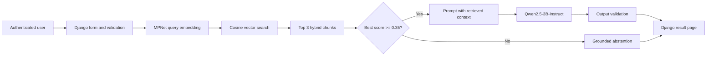

# A9 Stage 4: Final Integration, Documentation and Quality Assurance

Owner: Ashley Zhou, Team 3 — CozyDay  
Final feature: `/planitems/ai-rag-planner/` (login required)

This package closes the A9 Django AI Integration work after Stages 1–3 were
merged. It connects the implementation, measured evidence, failure analysis,
reproducibility instructions, privacy review and in-person demonstration into one
auditable handoff. It does not replace the underlying A8 RAG experiment or invent
new evaluation results.

## 1. Complete user and data flow

1. An authenticated user enters a focused planning question in the Django form.
2. `AIRAGPlannerForm` strips the input, rejects empty input and enforces the length
   limit before any model runs. CSRF protection and `login_required` protect the page.
3. The view calls the thin `generate_rag_plan()` service contract. Exceptions are
   converted to safe messages; query text and model tracebacks are not shown or logged.
4. `planner/rag_engine.py` loads the shared CozyDay knowledge base and reuses the A8
   hybrid, topic-aware chunking strategy.
5. `sentence-transformers/all-mpnet-base-v2` converts the query to a normalized
   768-dimensional embedding. The process reuses the embedding model and the cached
   knowledge-base vectors instead of loading or recomputing them per request.
6. Cosine similarity ranks the chunks and returns Top-K = 3 with IDs, text and scores.
7. If the best score is below 0.35, the relevance gate skips generation and returns
   a grounded refusal. Otherwise the retrieved context, user query and system
   instruction are passed to `Qwen/Qwen2.5-3B-Instruct`.
8. The output contract checks answer type, sources and finite non-negative latency.
   Stage 3 completion validation removes only an unfinished tail caused by the token
   limit and adds a visible warning.
9. The Django result page shows the answer, collapsible retrieved sources, similarity
   scores, total latency, stage latencies and any warning.

## 2. Architecture diagram

The editable Mermaid source is [`architecture.mmd`](architecture.mmd).



## 3. Why these choices

| Component | Final choice | Evidence and tradeoff |
|---|---|---|
| Embedding | MPNet, 768d | A8 compared MiniLM 384d, MPNet 768d and BGE-large 1024d. MPNet matched the larger model on the five team queries without the larger vector/storage cost; MiniLM was cheaper but weaker on nearby planning topics. |
| Chunking | Hybrid topic groups, 230-word soft cap | A8 found hybrid chunks preserved complete thoughts without fixed-length sentence cuts or unrelated overlap. |
| Retrieval | Normalized cosine similarity, Top-K = 3 | A8 reached near-ceiling expected-evidence recall at three chunks; larger K added prompt length and noise. |
| Generation | Qwen2.5-3B-Instruct | The model was evaluated in A7 and reused unchanged across A8/A9. It is local, needs no paid API, fits a consumer machine more realistically than the strongest larger models, and produced structured grounded answers. |
| Decoding | Greedy, 300 new tokens | Deterministic evaluation and manageable latency, with a known risk of a cut-off long answer. Stage 3 output validation addresses presentation of that failure without changing the locked model. |

The detailed measured rationale and alternatives are in
[`../ai_integration_model_rationale.md`](../ai_integration_model_rationale.md).

## 4. Integrated evaluation

The authoritative data is
[`../ai_stage3_evaluation/stage3_results_final.csv`](../ai_stage3_evaluation/stage3_results_final.csv).
Every case was posted through the authenticated Django page, not directly to a notebook.

| Case | Final context score | Final answer score/behaviour | Total latency | Key observation |
|---|---:|---:|---:|---|
| Q1 paper breakdown | 3/3 | 3/3 | 21.04 s | Strong task breakdown; unfinished token-limit tail removed with warning. |
| Q2 competing deadlines | 3/3 | 3/3 | 5.02 s | Complete, concise prioritization. |
| Q3 spaced study plan | 3/3 | 2/3 | 6.67 s | Good spaced review, but omitted starting from fixed obligations. |
| Q4 private group sharing | 3/3 | 3/3 | 15.99 s | Correct privacy-preserving guidance. |
| Q5 progress report | 3/3 | 3/3 | 18.22 s | Correctly treats counts as descriptive; report structure could be clearer. |
| X1 unrelated fact | n/a | Abstained | 0.318 s | Best score 0.04; generation skipped. |
| X2 “help” | n/a | Abstained | 0.036 s | Best score 0.18; generation skipped. |

Generation accounts for more than 99% of latency when it runs. Embedding and retrieval
were each at most a few hundredths of a second in the recorded run. This identifies model
inference—not vector search—as the main local performance target.

## 5. Failures, root causes and improvement

| Failure | Root cause | Before | Shipped improvement / remaining limitation |
|---|---|---|---|
| Q1 ended with a dangling list number | 300-token generation limit, with a weak lower-ranked chunk encouraging padding | Incomplete text displayed as finished | Completion validation trims the unfinished tail and warns. It cannot recover omitted content. |
| X1 answered a France/Eiffel Tower question | Retrieval had no minimum score; the model used general knowledge despite the grounding prompt | Ungrounded answer after 2.97 s generation | A 0.35 relevance gate skips generation and returns an honest refusal in 0.318 s. |
| X2 “help” produced unrelated login tips | Input was syntactically valid but semantically vague; retrieval returned weak context | Unrelated answer after 11.9 s | The same gate refuses at score 0.18 in 0.036 s. A future form could require a more specific question. |
| Q3 omitted “start from fixed obligations” | The generator under-used the strongest retrieved chunk | Partial answer despite correct retrieval | Documented rather than hidden. A future reranker or prompt change should be evaluated on the same fixed cases. |

The improvement preserved Q1–Q5 retrieval and answer scores while correcting both probe
failures. The threshold is based on only seven cases: legitimate borderline questions may
be refused, and the best-chunk-only gate does not remove weak second or third chunks.

## 6. Privacy, security and repository hygiene

- The page requires login and POST requests use CSRF protection.
- The RAG corpus is shared project guidance; it does not retrieve PlanItems or other
  user records. The `user` argument is reserved for a future user-scoped design.
- The UI tells users not to enter names, addresses, health information or other
  sensitive details.
- User query text is not logged. Raw exceptions, tokens and local paths are never shown.
- `.env` is ignored; Django, Google OAuth and Gemini secrets stay in environment variables.
- Hugging Face weights and common local model formats are ignored. The repository contains
  only the small, content-hash-validated embedding cache needed for repeatability.
- The committed evaluation CSV and screenshots contain only fixed test prompts and no
  personal data.

## 7. Known limitations and production design

- First use needs about 6.5 GB of model downloads and enough RAM for Qwen2.5-3B.
- CPU generation measured 5–21 seconds. The current single-process in-memory model is
  appropriate for a local classroom demonstration, not many concurrent users.
- The timeout stops Django waiting but cannot stop the background generation thread.
- The vector store is a small NumPy cache, not a transactional or distributed vector DB.
- The knowledge base is static and shared; there is no per-user indexing or citation URL.

For production, run model inference in a separate worker/service with a hard job timeout,
queue and concurrency limits; prewarm and monitor the model; store vectors in FAISS or a
managed vector database; version the corpus and index; add per-user access control before
indexing private records; rate-limit requests; record privacy-safe metrics; and horizontally
scale stateless Django workers independently from inference workers.

## 8. Reproduce from a fresh clone

```bash
git clone https://github.com/AshleyZhou-31/3_CozyDay.git
cd 3_CozyDay
python3 -m venv .venv
source .venv/bin/activate
python -m pip install --upgrade pip
python -m pip install -r requirements.txt
cp .env.example .env
# Replace DJANGO_SECRET_KEY=changeme with a generated value.
python manage.py migrate
python manage.py check
python manage.py test
python manage.py runserver
```

Create an account, log in, and open `/planitems/ai-rag-planner/`. The first real request
downloads the models. Automated tests mock models and therefore require no model download.

Real-model checks:

```bash
python manage.py rag_smoke_test
python manage.py rag_evaluate --variants improved --cases Q1,Q3,X1 \
  --out /tmp/cozyday-final-rehearsal.csv --force
```

## 9. Final QA and evidence map

| Requirement | Evidence |
|---|---|
| Django input → model → output flow | `planner/forms.py`, `planner/views.py`, `planner/rag_planner.py`, `planner/rag_engine.py`, template |
| Model/settings rationale | `docs/ai_integration_model_rationale.md` |
| Five realistic success evaluations | `docs/ai_stage3_evaluation/stage3_results_final.csv`, Q1–Q5 |
| At least two failures | Same CSV and Stage 3 README, X1/X2 plus Q1 truncation |
| Before/after improvement | Baseline/improved rows and screenshots in `docs/ai_stage3_evaluation/` |
| Automated safety/regression coverage | `planner/test_ai_rag_planner.py`, `test_rag_engine.py`, `test_rag_stage3_regression.py`, `test_rag_evaluate_command.py` |
| Architecture and final explanation | This document and `architecture.mmd` |
| Demo plan and backup evidence | `demo_rehearsal.md` and committed Stage 3 screenshots |

The final command results recorded during Stage 4 are in [`final_qa.md`](final_qa.md).
